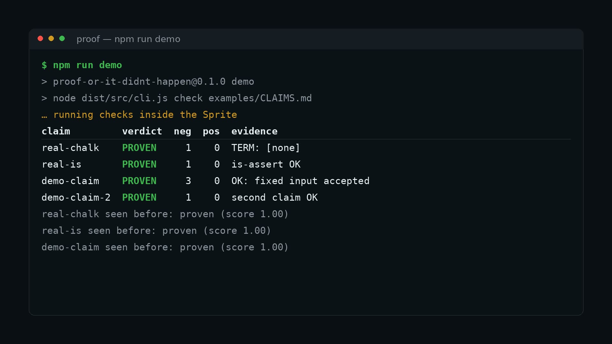

# Proof or It Didn't Happen

A claim is proven only when its negative test fails and its positive test
passes — re-run inside a Fly Sprite, with the evidence remembered in
Pinecone. Nothing is proven by assertion alone.



**[Watch the demo (77s, with narration)](docs/demo.mp4)** — the real
`npm run demo` run: four claims, two against the real chalk and is repos,
all proven, all remembered.

## What it does

`proof check <CLAIMS.md>` reads a claims file, runs each claim's two
commands inside a Sprite, and prints a verdict table:

- **negative** — the broken input. Must exit non-zero, or the claim is owed.
- **positive** — the fixed input. Must exit 0 **and** print something,
  or the claim is owed.
- Exit code is 0 only when every claim is proven.

Before running a claim, the gate recalls its previous evidence from
Pinecone (`<id> seen before: proven (score 1.00)`); after running, it
stores the new verdict. A claim is therefore provably tested before,
not just asserted now. Memory also has a job in the verdict path: if a
claim was proven before and is owed now, the run prints
`<id> REGRESSION: was proven before, now owed` — the world changed under
an unchanged claim. No language model is involved in the verdict —
verdicts are exit codes; Pinecone embeddings are deterministic retrieval.

## Prerequisites

- Node.js 24+, npm.
- A [Fly.io](https://fly.io) account and the
  [Sprite CLI](https://fly.io/sprites/) (`sprite login`).
- A Sprite named `proof-or-it-didnt-happen` in your Sprite org
  (`sprite create proof-or-it-didnt-happen`). Point the tool at your own
  Sprite with `SPRITE_ORG` and `SPRITE_NAME`.
- A [Pinecone](https://www.pinecone.io) account with a Sprites Pinecone
  connector whose access is granted to sprites named `proof-*`, and a
  legacy dense index named `proof-claims` (1024 dimensions, cosine).
  Point the tool at your own connector with
  `PINECONE_GATEWAY_CONNECTION_ID`.
  The Pinecone console only creates document-schema indexes; a legacy
  index needs the control-plane API:

```sh
curl -X POST https://api.pinecone.io/indexes \
  -H "Api-Key: $PINECONE_API_KEY" \
  -H "X-Pinecone-Api-Version: 2025-10" \
  -d '{"name":"proof-claims","dimension":1024,"metric":"cosine",
       "vector_type":"dense",
       "spec":{"serverless":{"cloud":"aws","region":"us-east-1"}}}'
```

## Run it

```sh
npm install
npm run demo               # 4 claims (chalk + is first, then 2 seeded), ~75s
npm test                   # 20+ tests, including a real-Sprite end-to-end run
```

## How it works

```
CLAIMS.md --parse--> claims --+--> Sprite (sprite exec, sh -c)
                              |      negative fails? positive passes?
                              +--> verdict table (exit 0 iff all proven)
Pinecone <--gateway-- sprite/pinecone.py (store/recall, /embed + vectors)
```

- `src/claims.ts` — strict CLAIMS.md parser (duplicate ids/fields throw).
- `src/runner.ts` — the red-to-green rule: negative must fail, positive
  must pass with non-empty output.
- `src/pinecone.ts` + `sprite/pinecone.py` — evidence store/recall through
  the Sprites gateway; the gateway attaches the Pinecone key by Sprite
  identity, so no credential lives in this repo. Recall embeds with the
  same `passage` input type as store (a `query`-type embed of identical
  text scores only ~0.86 and misses).
- `src/sprite.ts` — Sprite exec wrapper; evidence lives under
  `/home/sprite`, never `/tmp` (tmpfs does not survive a checkpoint restore).

## Claims files

- `examples/CLAIMS.md` — the demo: the gate against two real public repos
  first (chalk's own suite, `@sindresorhus/is` via
  `fixtures/is-assert.mjs`), then two seeded fixture claims.

## Known limitations

- The loop itself runs locally as a CLI; the Sprite executes the tests.
  A resident service on the Sprite would be a different project.
- Two checks must not run against the same Sprite at the same time: the
  demo claims share `/home/sprite/targets`, so a parallel run can delete
  the other's freshly cloned repo mid-test. The test suite runs serially
  (`--test-concurrency=1`) for the same reason.
- One exec per command, 120s timeout, no retry.
- Recall counts a match at cosine score >= 0.9.
- The gate trusts exit codes: a test that exits 0 without testing
  anything can only be caught by the non-empty-output rule.

## License

MIT
